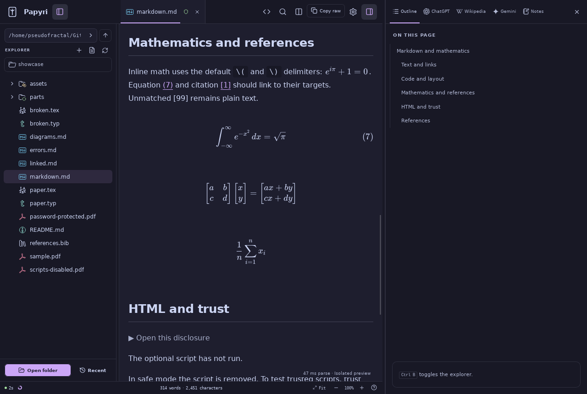

<p align="center">
  
</p>

# Papyri

Papyri is a local-first viewer and source editor for Markdown, PDF, Typst, and LaTeX. It renders mathematics and diagrams offline, keeps documents editable, and runs natively on Linux, macOS, and Windows.



- Preview Markdown, PDF, Typst, and LaTeX with math, diagrams, citations, and outlines.
- Edit and save sources with draft recovery, conflict detection, and language-server completions.
- Build bibliographies with DOI, arXiv, and PubMed lookup.
- Read and research beside the document with embedded browser tabs on desktop.
- Drive a running window from editors and scripts with `papyri ctl`.

## Install

Download the latest [release](https://github.com/pseudofractal/papyri/releases/latest). Releases include an AppImage and `.deb` for Linux, a `.dmg` for Intel and Apple Silicon Macs, and an NSIS installer for Windows.

On Linux, Nix users can install or run Papyri directly:

```sh
nix profile install github:pseudofractal/papyri
nix run github:pseudofractal/papyri -- path/to/document.md
```

## Build

```sh
nix develop
npm ci
npm run tauri dev
```

The Nix development shell works on Linux. macOS and Windows builds need the platform toolchains described in [platform support](docs/platform.md).

## Documentation

AI agents can run `papyri skill` for a compact guide to the control API and setup.

- [Document support](docs/documents.md): formats, compilation, fonts, packages, and browser-mode limits
- [Platform support](docs/platform.md): capabilities, build instructions, and the Android boundary
- [Agent guide](docs/agent-guide.md): using Papyri from an AI agent or editor
- [Control API](docs/control.md): `papyri ctl`, editor integration, screenshots, and native input
- [Security](docs/security.md): trust model and isolation boundaries
- [Release notes](docs/release-notes.md): install formats and known limitations

## Third-party notices

Bundled icons include [Codicons](https://github.com/microsoft/vscode-codicons) by Microsoft and contributors, under [CC BY 4.0](https://creativecommons.org/licenses/by/4.0/) (artwork) and the MIT license (code), and Catppuccin icons under the MIT license. License texts ship with the application.

## License

[MIT](LICENSE)
