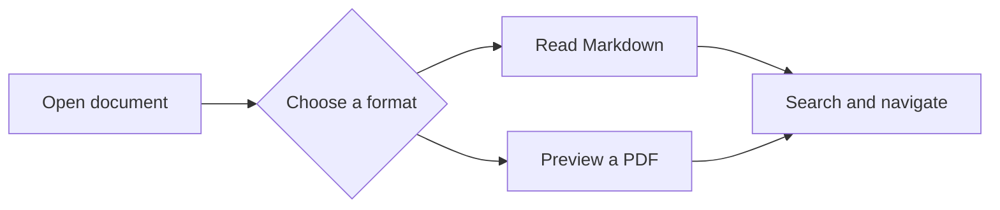
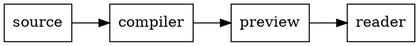
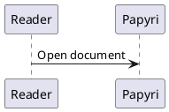

# Diagrams and charts

[Back to the showcase](./README.md)

Each supported block starts as source. Click its **Render** button, then try expanding it, scrolling, closing it, and updating its theme.

## Mermaid



## Graphviz



## Vega

```vega
{
  "$schema": "https://vega.github.io/schema/vega/v6.json",
  "width": 300, "height": 140, "padding": 5,
  "data": [{"name": "table", "values": [{"x": "A", "y": 28}, {"x": "B", "y": 55}, {"x": "C", "y": 43}]}],
  "scales": [{"name": "x", "type": "band", "range": "width", "domain": {"data": "table", "field": "x"}, "padding": 0.1}, {"name": "y", "type": "linear", "range": "height", "domain": {"data": "table", "field": "y"}, "zero": true}],
  "axes": [{"orient": "bottom", "scale": "x"}, {"orient": "left", "scale": "y"}],
  "marks": [{"type": "rect", "from": {"data": "table"}, "encode": {"enter": {"x": {"scale": "x", "field": "x"}, "width": {"scale": "x", "band": 1}, "y": {"scale": "y", "field": "y"}, "y2": {"scale": "y", "value": 0}}}}]
}
```

## Vega-Lite

```vega-lite
{
  "$schema": "https://vega.github.io/schema/vega-lite/v6.json",
  "data": {"values": [{"day": "Mon", "pages": 12}, {"day": "Tue", "pages": 24}, {"day": "Wed", "pages": 18}]},
  "mark": "bar",
  "encoding": {"x": {"field": "day", "type": "nominal"}, "y": {"field": "pages", "type": "quantitative"}}
}
```

## PlantUML limitation

This block intentionally remains source with an explanation: Papyri does not currently include a local PlantUML renderer.


